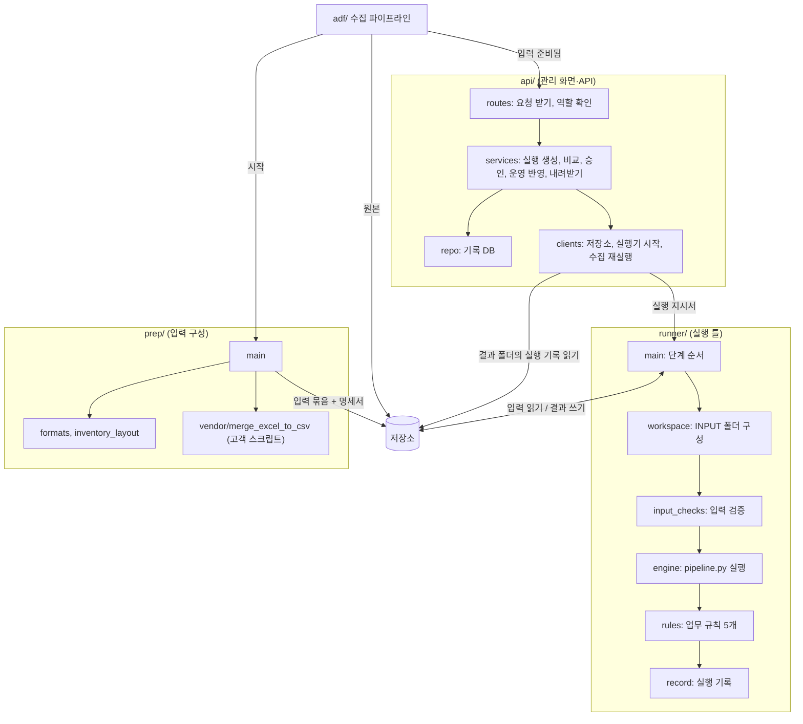
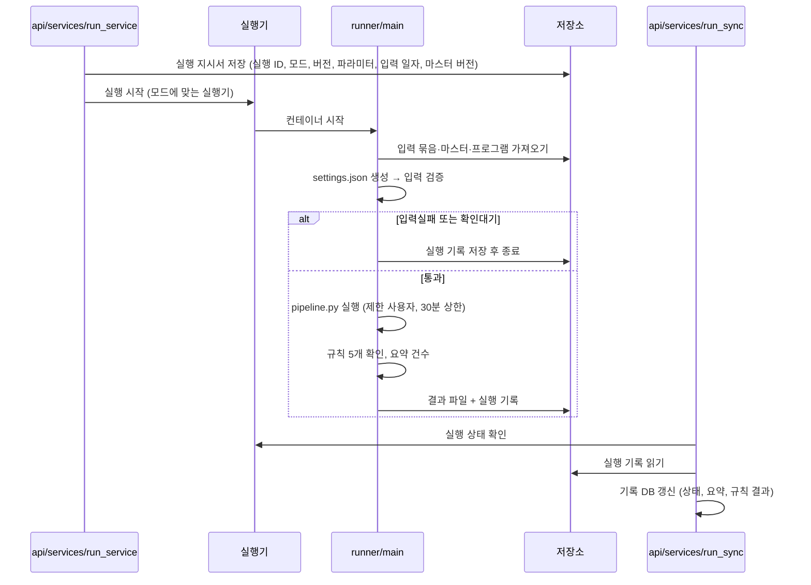

# 롯데면세점 재고배분 PoC Design

**Spec**: `.specs/features/allocation-poc/spec.md`
**Status**: Draft

전체 구조와 Azure 서비스 선택의 근거는 `artifacts/system_design_allocation-poc.md`와 `artifacts/adr_*.md`에 있다. 이 문서는 그 구조를 만들 단위(폴더, 모듈, 주고받는 것)로 나눈다. 파일 경로는 새로 만들 프로젝트 저장소 기준이며, 개발 도구(FastAPI, Bicep, pytest)는 제안이다.

---

## Architecture Overview

만드는 것은 다섯 덩어리다. 수집과 인프라는 설정이고, 나머지 셋은 Python 프로그램이다.

| 덩어리 | 폴더 | 하는 일 | 실행되는 곳 |
| --- | --- | --- | --- |
| 실행 틀 | `runner/` | 입력 배치 → 입력 검증 → 프로그램 실행 → 규칙 확인 → 기록 | 실행기 (Container Apps Job) |
| 입력 구성 | `prep/` | 수집 원본과 올린 파일을 현행 파일 형식으로 변환 | 입력 구성 (Container Apps Job) |
| 관리 화면·API | `api/` | 화면 8개, 실행 요청, 비교, 승인, 내려받기 | App Service |
| 수집 | `adf/` | 기간계 조회, 원본 저장, 입력 구성 시작, 입력 준비됨 알림 | Data Factory |
| 인프라 | `infra/` | 저장소, 권한, 네트워크, 실행기, DB, 웹 앱 정의 | Azure 배포 |

### 실행 1건의 순서

### 규칙이 실행되는 곳

사용자가 보는 값을 바꾸는 규칙은 모두 테스트가 닿는 층에 둔다.

| 규칙 | 위치 |
| --- | --- |
| 입력 검증, 업무 규칙 5개, 실행 상태 판정, 요약 건수 | `runner/` |
| 건수 차이, 달라진 SKU, 실행일 경고 | `api/services/compare` |
| 승인·운영 반영의 허용과 거절, 운영 버전 1개 유지 | `api/services/approval`, `promotion` |
| 내려받기 허용, 파일 순서, 검증용 표시 | `api/services/download` |
| 역할별 허용 | `api/auth` |

화면(`api/templates/`)은 서비스가 준 값을 보여주기만 한다. 정렬, 필터, 건수 계산을 화면에서 하지 않는다.

---

## Code Reuse Analysis

### Existing Components to Leverage

| Component | Location | How to Use |
| --- | --- | --- |
| 배분 프로그램 | 고객 제공 `pipeline.py` (1,764줄) | 수정 없이 실행한다. 첫 운영 버전으로 등록한다 |
| 재고 합본 스크립트 | 고객 제공 `merge_excel_to_csv.py` (133줄) | `prep/vendor/`에 그대로 두고 호출한다 |
| 검증 불변식 정의 | 고객 제공 `CLAUDE.md` | 업무 규칙 5개의 계산식 근거로 쓴다 |
| 현재 운영 파라미터 | 고객 제공 `settings.json` (양수도INPUT 폴더의 것) | 운영 파라미터 초기값. 저장소 안 `stck_routing_process/settings.json`은 예전 검증용 값이라 쓰지 않는다 |
| 기준 데이터 | 0812 입력과 그 결과 폴더, 0813 입력 | 회귀 기준, 차단 사례, 테스트 고정 데이터 |
| 일일결과리포트 HTML | 프로그램이 만드는 `일일결과리포트_YYYYMMDD.html` | 결과 화면에 그대로 넣어 보여준다 |

현행 화면 `app.py`(Streamlit)는 쓰지 않는다. 이 화면이 하던 일(파라미터를 settings.json에 쓰고 프로그램을 호출)은 실행 틀이 대신한다.

이 저장소에는 재사용할 기존 코드가 없다. 위 항목은 모두 고객에게 받아야 한다.

### Integration Points

| System | Integration Method |
| --- | --- |
| 정보계 (판매예측, 코드표 5종) | Data Factory가 수집 중계 서버를 통해 테이블을 조회한다 |
| L-lit (재고), L-DEX (공헌이익) | 원천 테이블이 확인되면 같은 방식. 확인 전에는 화면에서 내려받은 파일을 올린다 |
| ERP | 연계하지 않는다. 담당자가 결과 파일을 내려받아 직접 올린다 |
| Microsoft Entra ID | App Service의 기본 로그인 기능과 앱 역할 4개 |
| 메일 | Logic Apps로 보낸다 |

---

## Components

### runner/main

- **Purpose**: 실행 지시서를 읽어 단계를 순서대로 돌리고 실패한 단계에서 멈춘다
- **Location**: `runner/main.py`
- **Interfaces**:
  - 입력: 실행 ID (환경 변수). 지시서는 저장소에서 읽는다
  - 출력: 결과 폴더의 결과 파일과 실행 기록, 종료 코드
- **Dependencies**: instruction, storage, workspace, settings_file, input_checks, engine, rules, summary, record
- **Reuses**: 없음

### runner/instruction, runner/storage

- **Purpose**: 지시서를 읽고 필수 항목을 확인한다 / 저장소의 구역별 읽기·쓰기를 감싼다
- **Location**: `runner/instruction.py`, `runner/storage.py`
- **Interfaces**:
  - 지시서 항목: 실행 ID, 모드(검증·운영·회귀), 프로그램 버전, 파라미터 값 14개, 입력 일자, 마스터 버전(종류별), 입력 검증만 여부
  - storage: 입력 묶음 가져오기, 마스터 가져오기, 프로그램 가져오기, 결과 올리기. 입력과 프로그램 구역에는 쓰기 기능이 없다
- **Dependencies**: Azure 저장소 (테스트에서는 로컬 폴더 구현)
- **Reuses**: 없음

### runner/workspace, runner/settings_file

- **Purpose**: 컨테이너 안에 현행 INPUT 폴더와 같은 모양의 작업 폴더를 만든다 / 파라미터로 settings.json을 만든다
- **Location**: `runner/workspace.py`, `runner/settings_file.py`
- **Interfaces**:
  - workspace: 입력 묶음 8종 + 마스터 2종 + pipeline.py를 한 폴더에 놓고 출력 폴더를 만든다. 없는 마스터는 경고로 돌려준다
  - settings_file: 파라미터 14개와 입출력 폴더 경로를 현행 settings.json 키로 쓴다
- **Dependencies**: storage
- **Reuses**: 현행 settings.json의 키 이름

### runner/input_checks

- **Purpose**: 실행 전에 입력이 온전한지 확인한다
- **Location**: `runner/input_checks.py`, 기준 컬럼은 `runner/baseline_columns.json`
- **Interfaces**:
  - 입력: 작업 폴더, 모드, 입력 일자
  - 출력: 항목별 결과(통과·경고·실패)와 내용, 종합 판정(통과·확인대기·입력실패)
  - 항목: 필수 파일, 코드표 5종, 재고 컬럼 72개의 이름과 순서, 카테고리 6개, 점 10개, 갱신 주기
- **Dependencies**: pandas (재고 파일 읽기)
- **Reuses**: 0812 합본 CSV의 헤더를 기준으로 등록한다

### runner/engine

- **Purpose**: 현업의 pipeline.py를 격리해서 실행한다
- **Location**: `runner/engine.py`
- **Interfaces**:
  - 입력: 작업 폴더, 입력 일자, 시간 상한(30분)
  - 출력: 종료 상태(정상·오류·시간 초과·결과 없음), 로그 마지막 200줄
  - 실행 방식: `python pipeline.py YYYYMMDD`를 저장소 접근 권한이 없는 별도 사용자로, 환경 변수를 비운 채 실행한다
- **Dependencies**: 실행 이미지의 제한 사용자
- **Reuses**: 고객 pipeline.py (수정 없음)

### runner/rules, runner/summary, runner/record

- **Purpose**: 업무 규칙 5개를 확인한다 / 요약 건수 5개를 뽑는다 / 실행 기록을 쓴다
- **Location**: `runner/rules.py`, `runner/summary.py`, `runner/record.py`
- **Interfaces**:
  - rules: 결과 폴더 + 작업 폴더 + 파라미터 → 규칙별 통과 여부와 위반 건수, 종합 판정
  - summary: 결과 폴더 → 배분 검토 상품, 점간 이동 지시, 온·오프 전환 지시, 미충전 부족분, 발주 검토 대상
  - record: 모드, 요청자, 버전, 파라미터 사본, 입력 일자, 마스터 버전, 시작·종료 시각, 상태, 입력 검증 결과, 규칙 결과, 요약을 한 파일로 쓴다
- **Dependencies**: pandas, openpyxl (결과 엑셀 읽기)
- **Reuses**: 고객 CLAUDE.md의 불변식 정의, 검토리포트 엑셀의 요약 시트

### prep

- **Purpose**: 일자별 입력 묶음을 현행 파일 형식으로 만든다
- **Location**: `prep/main.py`, `prep/formats.py`, `prep/inventory_layout.py`, `prep/manifest.py`, `prep/vendor/merge_excel_to_csv.py`
- **Interfaces**:
  - 입력: 일자, `raw/`의 수집 원본, 사람이 올린 파일
  - 출력: `input/YYYYMMDD/`의 8종 파일과 명세서, 입력 묶음 상태(준비됨·실패)
  - 매일 수집하지 않는 원천은 가장 최근 수집분을 넣는다
- **Dependencies**: pandas, openpyxl
- **Reuses**: 고객 합본 스크립트

### api/services

- **Purpose**: 화면이 요청한 일을 규칙에 따라 처리한다
- **Location**: `api/services/` 아래 모듈

| 모듈 | 하는 일 |
| --- | --- |
| `code_check` | 올린 파일의 문법과 허용 라이브러리 검사 |
| `parameter_service` | 운영 파라미터 초기값, 범위 확인, 변경 이력 |
| `master_service` | 마스터 버전 보관, 시트 6개 확인 |
| `run_service` | 실행 생성, 지시서 작성, 모드에 맞는 실행기 시작, 비교용 동반 실행 |
| `run_sync` | 실행기 상태와 결과 폴더의 기록을 읽어 DB 갱신 |
| `compare` | 두 실행의 건수 차이와 달라진 SKU |
| `approval` | 운영 결과 승인 |
| `promotion` | 운영 반영 요청, 회귀 실행, 승인·반려·되돌리기 |
| `download` | 내려받기 허용, 파일 순서, 검증용 표시 |
| `notify`, `timing` | 알림 보내기, 구간별 시각 기록 |

- **Dependencies**: repo, clients
- **Reuses**: 없음

### api/routes, api/auth, api/templates

- **Purpose**: 요청을 받아 역할을 확인하고 서비스를 부른다 / 화면 8개를 그린다
- **Location**: `api/routes/`, `api/auth.py`, `api/templates/`
- **Interfaces**: 경로 목록은 `artifacts/system_design_allocation-poc.md`의 인터페이스 표를 따른다
- **Dependencies**: services, Entra ID
- **Reuses**: 일일결과리포트 HTML을 결과 화면에 넣는다

### api/repo, api/clients

- **Purpose**: 기록 DB 읽기·쓰기 / 저장소, 실행기, 수집 파이프라인 호출
- **Location**: `api/repo/models.py`, `api/repo/db.py`, `api/clients/blob_client.py`, `job_client.py`, `adf_client.py`
- **Dependencies**: Azure SQL, ADLS, Container Apps, Data Factory
- **Reuses**: 없음

### adf, infra

- **Purpose**: 수집 파이프라인 정의 / Azure 자원 정의
- **Location**: `adf/pl_collect_daily.json`, `infra/*.bicep`
- **Interfaces**:
  - 파이프라인: 원천별 조회 → `raw/` 저장 → 입력 구성 시작 → 관리 API에 입력 준비됨 알림. 실패하면 실패한 원천 이름을 알린다
  - 인프라: 저장소 구역 4개, 실행기 2개와 입력 구성 1개, 실행기별 ID와 구역별 권한, 외부 통신 차단, DB, 웹 앱, Data Factory, Logic Apps
- **Dependencies**: 고객 Azure 환경, 수집 중계 서버, 기간계 접근 승인

---

## Data Models (if applicable)

테이블의 항목은 `artifacts/system_design_allocation-poc.md`의 데이터 모델 표를 따른다. 여기에는 덩어리 사이에 오가는 파일 세 가지를 적는다.

### 실행 지시서 (관리 API → 실행기)

| 항목 | 내용 |
| --- | --- |
| 실행 ID | 관리 API가 준다 |
| 모드 | 검증, 운영, 회귀 |
| 프로그램 버전 | 버전 ID와 내용 지문 |
| 파라미터 | 14개 값 전체 (실행 시점 사본) |
| 입력 일자 | YYYYMMDD |
| 마스터 버전 | 양수도 그룹, 제외·전용 SKU 각각 |
| 요청자, 요청 시각 | |
| 계속 실행 여부 | 확인대기에서 담당자가 계속을 눌렀는지 |

### 실행 기록 (실행기 → 관리 API)

| 항목 | 내용 |
| --- | --- |
| 지시서 사본 | 위 항목 전체 |
| 시작·종료 시각, 상태 | 입력실패, 확인대기, 실행오류(사유), 규칙위반, 완료 |
| 입력 검증 결과 | 항목별 통과·경고·실패와 내용 |
| 규칙 결과 | 5개 각각 통과 여부, 위반 건수, 위반 예시 |
| 요약 건수 | 5개 |
| 프로그램 로그 | 마지막 200줄 |

### 입력 묶음 명세서 (입력 구성 → 실행기, 관리 API)

| 항목 | 내용 |
| --- | --- |
| 일자, 상태 | 준비됨, 실패(사유) |
| 파일별 | 파일 이름, 출처(자동 수집·올린 파일), 수집 시각, 원본의 일자, 행 수, 내용 지문 |

**Relationships**: 실행 기록은 지시서를 포함하고, 지시서는 입력 일자로 명세서를 가리킨다. 세 파일만 있으면 DB 없이도 한 실행을 재현할 수 있다.

---

## Error Handling Strategy

| Error Scenario | Handling | User Impact |
| --- | --- | --- |
| 원천 조회 실패 | 입력 묶음을 `실패`로 기록, 실패한 원천 이름 저장, 알림 | 입력 상태 화면에서 재수집을 요청하거나 파일을 올린다 |
| 재고 컬럼이 기준과 다름 | 입력 구성 단계에서 `실패`. 올린 파일이면 실행 시 `입력실패` | 다른 컬럼의 위치와 이름을 본다 |
| 카테고리·점 누락, 필수 파일 없음 | `입력실패`, 프로그램 실행 안 함 | 빠진 항목의 이름을 본다. 결과 파일은 없다 |
| 갱신 주기 초과 | 운영은 `확인대기`, 검증은 경고만 | 운영은 [실행 계속]을 눌러야 진행된다 |
| 프로그램 오류 | `실행오류`, 로그 마지막 200줄 저장 | 결과 화면에서 로그를 본다 |
| 30분 초과 | 실행 중단, `실행오류`(시간 초과) | 위와 같다 |
| 결과 파일이 하나도 없음 | `실행오류`(결과 없음) | 위와 같다 |
| 실행기를 시작하지 못함 | `실행오류`(실행기 시작 실패) | 다시 실행을 요청한다 |
| 규칙 위반 | `규칙위반`. 승인과 운영 반영 요청을 거절 | 위반한 규칙과 건수를 본다 |
| 입력 준비됨 알림이 두 번 옴 | 두 번째는 무시 | 영향 없음 |
| 역할 밖 기능 호출 | 거절 | "권한이 없습니다" |

---

## Risks & Concerns

이 저장소에는 대상 코드가 없어 파일 위치를 적을 수 없다. 아래는 고객 PDF가 알려 준 현행 프로그램의 문제와 설계상의 위험이다.

| Concern | Location (file:line) | Impact | Mitigation |
| --- | --- | --- | --- |
| 재고 컬럼을 순서로 읽음 | 고객 `pipeline.py` (줄 번호 미확인, PDF 5-①) | 컬럼이 하나 밀리면 조용히 틀린 값이 들어간다. 현재 69번 자리에서 발주번호를 읽는다 | 기준 72개 컬럼과 이름·순서를 대조한다. 오류 자체는 고치지 않는다 |
| 전역 변수에 상태 저장 | 고객 `pipeline.py` (PDF 5-⑥) | 한 프로세스에서 두 건을 돌릴 수 없다 | 실행마다 새 컨테이너 |
| 날짜 판정에 실행일을 씀 | 고객 `pipeline.py` (PDF 5-⑦) | 과거 결과를 재현할 수 없다 | 비교는 같은 날 실행한 결과끼리. 시간대는 Asia/Seoul |
| 파일을 이름순 마지막으로 선택 | 고객 `pipeline.py`의 `find_file` (PDF 5-⑤) | 비슷한 이름의 다른 파일을 읽을 수 있다 | 작업 폴더에 그 실행의 파일만 놓는다 |
| 자동 테스트 없음 | 고객 저장소 전체 (PDF 5-⑪) | 수정의 영향을 알 수 없다 | 규칙 5개 자동 확인, 0812 회귀 |
| 한국어 Windows에서 만든 프로그램 | 고객 `pipeline.py` | Linux에서 결과가 다를 수 있다 | 첫 작업으로 0812 재현을 확인한다. 다르면 실행기 선택을 다시 한다 |
| 현행 결과가 규칙 5개를 통과하는지 모름 | — | 통과하지 못하면 매일 승인이 막힌다 | 첫 작업에서 함께 확인한다 |
| L-lit·L-DEX 원천 테이블 미확인 | — | 자동 수집 범위가 줄어든다 | 파일 올리기 경로를 같은 입력 구성으로 받는다 |
| 프로그램에 저장소 권한이 넘어가지 않게 하는 방법 미검증 | `runner/engine.py` (작성 예정) | 격리가 약해진다 | 쓰기와 외부 접속을 시도하는 시험용 프로그램으로 배포 직후 확인한다 |
| Azure 서비스의 세부 동작을 공식 문서로 대조하지 않음 | `infra/`, `adf/` (작성 예정) | 구성 방식이 달라질 수 있다 | 인프라 작업 전에 개발팀이 문서로 확인한다 |

---

## Tech Decisions (only non-obvious ones)

| Decision | Choice | Rationale |
| --- | --- | --- |
| 실행기와 프로그램 사이의 약속 | 입력 폴더, settings.json, 출력 폴더 | 실행 틀이 프로그램 내부를 모르게 한다. `AD-001` |
| 실행기 분리 | 검증용과 운영용을 따로 두고 권한을 다르게 | 섞임을 권한으로 막는다. `AD-002` |
| 입력 형식 | 현행 파일 이름·형식 그대로 | 프로그램을 고치지 않는다. `AD-003` |
| 실행기는 DB에 쓰지 않음 | 결과 폴더의 실행 기록을 관리 API가 읽어 반영 | 실행기의 권한을 저장소로 한정한다 |
| 비교 계산의 위치 | 관리 API | 두 실행이 모두 끝난 뒤에만 할 수 있다 |
| 화면 기술 | 서버에서 그리는 화면 (FastAPI + 템플릿) | 프로그램과 같은 Python 하나로 만든다. 화면 8개 규모에 충분하다 |
| 인프라 정의 | Bicep | Azure 기본 도구다. 고객 표준이 다르면 바꾼다 |
| 날짜 고정 | 만들지 않음 | 프로그램 수정 없이 되는지 미확인. 같은 날 실행으로 대신한다 |
| 판매예측 파일 형식 | 0812로 확인한 뒤 엑셀과 단순형 CSV 중 선택 | 프로그램이 둘 다 읽는다고 고객 PDF에 있다. 결과가 같은지 확인이 먼저다 |
