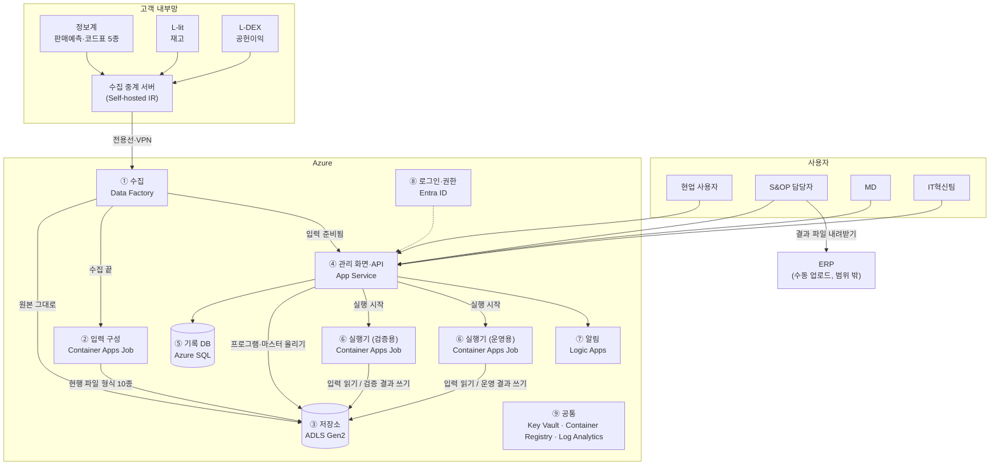
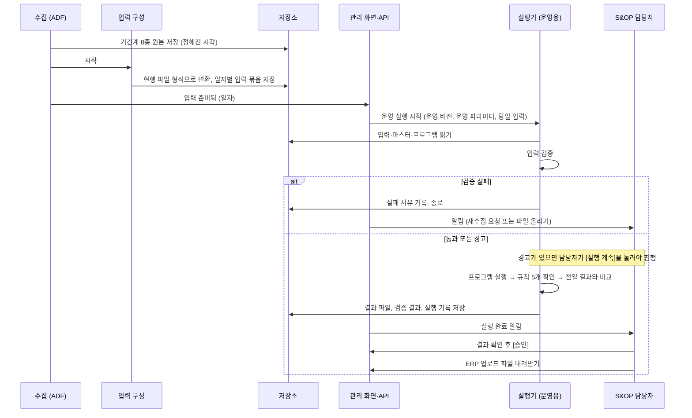
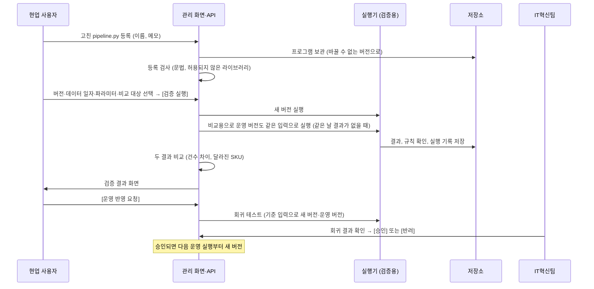
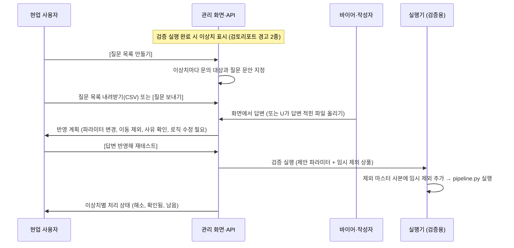
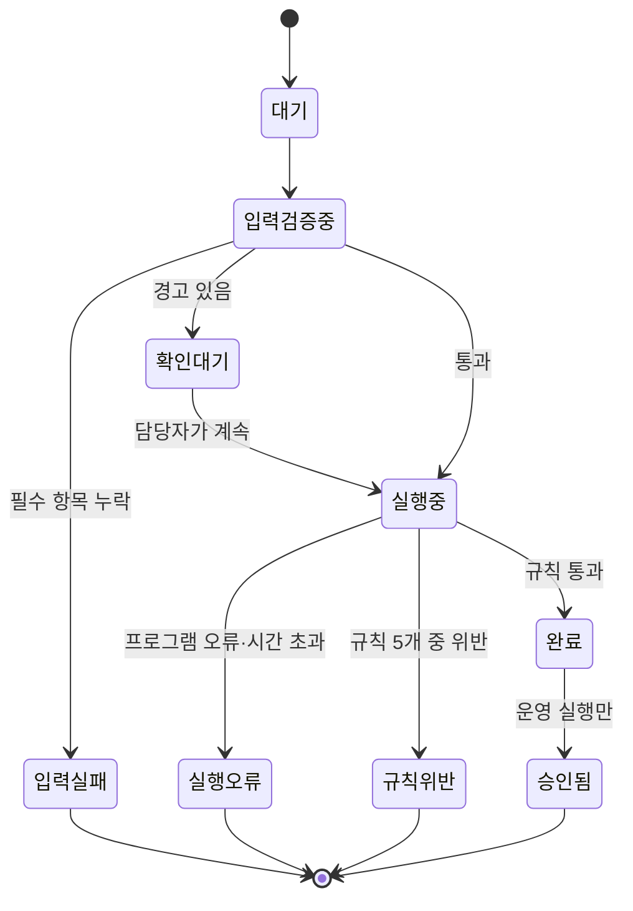

# 시스템 설계: 롯데면세점 재고배분 PoC

## 문서 정보 (Meta)

| 항목 | 내용 |
| --- | --- |
| 상태 | 초안 (승인 대기) |
| 작성 | jaewook ryu |
| 검토 | 고객사 IT혁신팀, S&OP 담당자 |
| 요구사항 문서 | `docs/superpowers/specs/2026-11-17-lotte-dfs-allocation-poc-design.md` |
| 결정 기록 | `artifacts/adr_data-ingestion.md`, `adr_execution-runner.md`, `adr_code-isolation.md`, `adr_validation-placement.md` |

Azure 서비스명은 제안이다. 고객 환경과 사내 표준을 확인한 뒤 확정한다. 요구사항 문서의 번호(R, N, D, Q)를 그대로 쓴다.

## 요약 (Executive Summary)

현업이 고친 재고배분 프로그램(pipeline.py)을 Azure에 올려 실행하고, 결과가 맞는지 자동으로 확인하는 시스템이다. 기간계 데이터는 Azure Data Factory가 매일 모아 현행과 같은 파일 형식으로 만들어 두고, 프로그램은 실행 1건마다 따로 뜨는 컨테이너에서 수정 없이 돈다.

같은 실행기를 두 가지로 쓴다. 현업이 고친 프로그램을 시험해 보는 **검증 실행**과, 승인된 프로그램이 매일 도는 **운영 실행**이다. 검증 실행에서 확인한 것이 운영 실행에서 그대로 재현되는 것이 이 구조의 목적이다.

## 아키텍처 개요 (Architecture Overview)

### 운영 실행의 흐름

### 검증 실행의 흐름

### 이상치 질문·답변과 재테스트의 흐름

검증 실행에만 적용한다 (요구사항 확정서 12장).

### 고객 PPT 5쪽 구상과의 대응

| PPT 5쪽 | 이 설계 |
| --- | --- |
| ① 사용자 로컬 환경 (Claude 등 개발 도구) | 시스템 밖. 고친 파일을 관리 화면에서 등록 |
| ② AI 개발 샌드박스 (VDI) | 미확정(Q6). VDI에서 고쳐도 같은 등록 화면을 쓴다 |
| ③ 개발/배포 환경 (개발/테스트, 보안 검증, 소스코드 등록) | 프로그램 등록·검사, 검증 실행, 회귀 테스트, 운영 반영 승인 |
| ④ Azure Cloud 연계 환경 (API·DB 연계, 저장소, 권한 관리) | 수집(ADF), 저장소, 기록 DB, Entra ID |
| 접근 통제 (API Gateway, 인증, 접근권한) | PoC는 App Service의 Entra ID 로그인과 역할로 대신한다. API Gateway는 여러 프로그램을 수용하는 본사업에서 검토 |
| ⑤ 기간계 (L-lit, EP, MDM/SRM, L-DEX), 전용선/VPN | 수집 중계 서버를 통해 연결. EP, MDM/SRM은 재고배분 입력이 아니라 PoC 대상이 아님 |

## 주요 결정과 대안 (Key Decisions & Trade-offs)

| 결정 | 선택 | 검토한 대안 | 이유 |
| --- | --- | --- | --- |
| 데이터 수집 | Data Factory + 수집 중계 서버, 원본 저장 후 입력 구성 2단계 | ADF에서 최종 파일까지 직접 생성, 자체 수집 프로그램, 전부 수동 올리기 | 사용자 결정(D1). ADF는 엑셀을 쓸 수 없고 현행 파일 형식이 제각각이라 변환을 따로 둔다. `adr_data-ingestion.md` |
| 실행기 | Container Apps Job, 고정 이미지에 프로그램 파일을 넣어 실행 | Azure Functions, 버전마다 이미지 빌드, Azure Batch, AKS | 실행 1건당 컨테이너 1개로 동시 실행 문제(N2)를 프로그램 수정 없이 해결. `adr_execution-runner.md` |
| 현업 프로그램의 격리 | 검증용·운영용 실행기를 나누고 권한을 다르게, 외부 통신 차단 | 실행기 하나에 권한 하나, 프로그램 정적 검사만 | 검증용 결과가 운영 결과에 섞이는 것을 권한으로 막는다(R21). `adr_code-isolation.md` |
| 검증 로직의 위치 | 실행 컨테이너 안에서 프로그램 앞뒤로 수행 | 별도 Azure Functions, 관리 API 안 | 두 모드가 같은 검증을 쓰고, 서비스 수가 줄어든다. `adr_validation-placement.md` |
| 기록 DB | Azure SQL Database | PostgreSQL, Table Storage | 승인·이력은 관계형이 맞고 규모가 작다. 고객이 SQL Server 계열에 익숙할 가능성이 높다 (확인 필요) |
| 관리 화면 | App Service 웹 앱 하나 (화면 + API) | Streamlit 그대로 호스팅, 정적 화면 + Functions | 역할별 권한과 승인 흐름이 필요하다. Streamlit은 현업에 익숙하지만 역할 분리와 승인 처리가 약하다 |
| 운영 실행의 시작 | ADF가 수집을 마친 뒤 관리 API에 알리고, API가 실행을 시작 | 실행기를 시각으로 직접 예약 | "수집과 입력 구성이 끝난 뒤에만 실행"(R10)을 순서로 보장한다 |
| 알림 | Logic Apps (메일·Teams) | Azure Monitor 경보만, 메일 서비스 직접 호출 | 연결 대상을 설정으로 바꿀 수 있다. 채널은 Q16 |
| 프로그램 보관 | 저장소에 버전별 보관(내용 지문 기록), 상태는 DB | Git 저장소를 원본으로 | 현업은 파일을 올리는 방식이 가장 쉽다. 승인된 버전을 Git에도 남길지는 본사업에서 정한다 |

## 구성요소 (Components)

### ① 수집 — Azure Data Factory
- **하는 일**: 정해진 시각에 기간계 8종을 조회해 원본 그대로 저장소에 둔다. 끝나면 입력 구성을 시작시키고, 관리 API에 "입력 준비됨"을 알린다. 실패하면 알림을 보낸다
- **기술**: Data Factory 파이프라인, 한국 시간 기준 일정 트리거, 고객 내부망의 수집 중계 서버(Self-hosted Integration Runtime), 접속 정보는 Key Vault
- **수집 주기**: 재고 매일, 판매예측 매주 월요일, 공헌이익 매월, 코드표 5종 매일(변경 여부만 확인)
- **조건**: 원천별 접근 승인(Q1). 승인되지 않은 원천은 파이프라인에서 빼고 파일 올리기로 대신한다

### ② 입력 구성 — Container Apps Job
- **하는 일**: 원본을 현행 프로그램이 읽는 파일 이름과 형식으로 바꿔 일자별 입력 묶음을 만든다. 사람이 올린 재고 엑셀 6개는 고객의 기존 합본 스크립트(merge_excel_to_csv.py)로 합친다
- **만드는 형식** (D4: 현행 그대로)

| 입력 | 파일 이름 | 형식 |
| --- | --- | --- |
| 재고 | 상태별재고조회(SKU)_합본_YYYYMMDD.csv | CSV utf-8-sig, 72개 컬럼을 현행 순서로 |
| 판매예측 | 일예상판매수량_YYYYMMDD | 현행 엑셀 형식, 또는 프로그램이 인식하는 단순형 CSV (기준 입력으로 결과가 같은지 확인 후 선택) |
| 공헌이익 (선택) | 채널별상품공헌이익_YYYYMM.csv | UTF-16 탭 구분. 고객이 현재 미적용 중이라 파일이 없으면 만들지 않는다 |
| 코드표 5종 | 점코드_ / 브랜드코드_ / 코너코드_ / 창고코드_ / 재고관리년월코드_YYYYMMDD.csv | CSV cp949 |

- **입력 묶음 명세서**: 묶음마다 파일별 출처(자동 수집 또는 올린 파일), 수집 시각, 행 수, 내용 지문을 기록한다. 재고의 수집 시각이 곧 재고 기준 시각이다

### ③ 저장소 — ADLS Gen2
- **하는 일**: 원본, 입력 묶음, 마스터, 프로그램, 결과, 기준 데이터를 보관한다
- **구조** (권한을 나누기 위해 구역을 분리한다)

| 구역 | 경로 | 내용 |
| --- | --- | --- |
| 입력 | raw/<원천>/YYYYMMDD/ | ADF가 가져온 원본 |
| 입력 | input/YYYYMMDD/ | 입력 묶음 (기간계 8종, 현행 파일 이름) + 명세서 |
| 입력 | master/<종류>/<버전>/ | MD 마스터 엑셀 업로드본 |
| 입력 | baseline/<일자>/, cases/<이름>/ | 회귀 기준 입력, 부분 추출 사례 |
| 프로그램 | code/<버전>/pipeline.py | 등록된 프로그램. 등록 후 바꿀 수 없다 |
| 운영 결과 | prod/YYYYMMDD/<실행ID>/ | 운영 실행 결과 |
| 검증 결과 | test/<실행ID>/ | 검증 실행 결과 |

- 일자별 폴더에 그날 파일만 두므로 "이름순 마지막 파일" 문제(PDF 5-⑤)가 생기지 않는다

### ④ 관리 화면·API — App Service
- **하는 일**: 화면 9개와 그 뒤의 API. 실행 요청을 받아 실행기를 시작하고, 실행 상태를 확인해 기록 DB에 반영하고, 결과 비교를 계산하고, 승인을 처리한다
- **화면** (요구사항 문서 6장의 사용자 행동과 대응)

| # | 화면 | 사용자 | 하는 일 |
| --- | --- | --- | --- |
| S1 | 내 프로그램 버전 | 현업 | 파일 선택, 이름·메모 입력, 등록 |
| S2 | 검증 실행 | 현업 | 버전·데이터 일자·비교 대상 선택, 파라미터 조정, 실행 |
| S3 | 검증 결과 | 현업 | 건수 변화, 규칙 통과, 달라진 SKU 확인, 내려받기, 운영 반영 요청 |
| S4 | 운영 반영 승인 | IT혁신팀 | 회귀 테스트 결과 확인, 승인 또는 반려 |
| S5 | 마스터 데이터 | MD | 엑셀 올리기, 버전 목록 |
| S6 | 입력 상태 | S&OP | 입력 묶음과 검증 결과. 경고·실패 시 실행 계속, 재수집 요청, 파일 올리기 |
| S7 | 운영 실행·결과 | S&OP | 지금 실행, 결과 요약·리포트 확인, 승인 |
| S8 | 결과 내려받기 | S&OP | ERP 업로드 파일을 올리는 순서대로 제공 |
| Q | 질문·답변 | 현업, 바이어 | 이상치 질문 목록 만들기·내려받기·보내기, 답변 입력 또는 파일 올리기, 반영 계획 확인, 재테스트 |

- 실행 이력 조회는 S3와 S7의 목록으로 제공한다. 사용자·권한과 스케줄 관리 화면은 PoC에서 만들지 않고 Azure 설정으로 처리한다

### ⑤ 기록 DB — Azure SQL Database
- **하는 일**: 프로그램 버전, 파라미터, 실행, 검증 결과, 승인의 기록. 파일 자체는 저장소에 두고 DB에는 위치와 요약만 둔다

### ⑥ 실행기 — Container Apps Job (검증용, 운영용)
- **하는 일**: 실행 1건마다 컨테이너 하나를 띄워 다음을 차례로 하고 끝낸다
  1. 실행 지시서(프로그램 버전, 파라미터, 입력 일자, 마스터 버전)를 읽는다
  2. 입력 묶음, 마스터, 프로그램을 컨테이너 안 작업 폴더로 가져와 현행 INPUT 폴더와 같은 모양으로 놓는다
  3. 파라미터로 settings.json을 만든다
  4. 입력 검증을 한다. 실패하면 사유를 기록하고 끝낸다
  5. `python pipeline.py YYYYMMDD`를 권한이 제한된 별도 사용자로 실행한다
  6. 결과 파일로 업무 규칙 5개를 확인하고 요약 건수를 뽑는다
  7. 결과 파일, 검증 결과, 실행 기록을 저장소에 쓴다
- **기술**: 고정 이미지 하나(Python 3.14.7, pandas 3.0.5, numpy 2.5.3, openpyxl 3.1.5, 시간대 Asia/Seoul). 1·2·3·4·6·7은 우리가 만든 실행 틀이고, 5만 현업의 프로그램이다
- **두 개로 나눈 이유**: 같은 이미지를 쓰되 권한이 다르다. 검증용은 검증 결과 구역에만, 운영용은 운영 결과 구역에만 쓸 수 있다
- **제한**: 실행 시간 상한, CPU·메모리 상한, 외부 통신 차단. 초기값은 전체 추출 입력으로 실행 시간을 잰 뒤 정한다
- **날짜 고정**: 컨테이너의 날짜를 지정한 날로 속이는 방법(libfaketime)으로 프로그램 수정 없이 가능함을 확인했다. PoC에 넣을지는 고객 답에 따른다

### ⑦ 알림 — Logic Apps
- **하는 일**: 수집 실패, 입력 검증 실패, 실행 완료, 승인 요청을 메일이나 Teams로 보낸다. PoC에서는 시연 수준

### ⑧ 로그인·권한 — Microsoft Entra ID

| 역할 | 할 수 있는 일 |
| --- | --- |
| 현업 사용자 | 프로그램 등록, 검증 실행, 검증 결과 조회, 운영 반영 요청 |
| S&OP 담당자 | 입력 상태 처리, 운영 실행, 운영 결과 승인, 결과 내려받기 |
| MD | 마스터 올리기 |
| IT혁신팀 | 운영 반영 승인·반려, 운영 파라미터 변경 승인, 전체 조회 |
| 바이어 | 자기에게 온 이상치 질문에 답변 (질문·답변 화면만) |

한 사람이 여러 역할을 가질 수 있다(Q4).

### ⑨ 공통
- Key Vault(기간계 접속 정보), Container Registry(실행 이미지), Log Analytics(실행 로그와 수집 로그)

## 인터페이스 (API Design)

화면이 쓰는 API와 ADF가 부르는 API다. 주소와 항목 이름은 개발 단계에서 확정한다.

| 방식 | 경로 | 설명 | 역할 |
| --- | --- | --- | --- |
| POST | /code-versions | 프로그램 등록 (파일, 이름, 메모) | 현업 |
| GET | /code-versions | 버전 목록과 상태 | 전체 |
| GET | /input-sets | 일자별 입력 묶음과 검증 상태 | 전체 |
| POST | /input-sets/{일자}/files | 막힌 원천의 파일 올리기 | S&OP |
| POST | /input-sets/{일자}/recollect | 재수집 요청 (ADF 파이프라인 재실행) | S&OP |
| POST | /internal/input-ready | 입력 준비됨 알림. ADF만 호출 | ADF |
| POST | /masters/{종류} | 마스터 엑셀 올리기 | MD |
| GET | /parameters/prod | 운영 파라미터 조회 | 전체 |
| PUT | /parameters/prod | 운영 파라미터 변경 (이력 기록) | IT혁신팀 (Q2에 따라 조정) |
| POST | /runs | 실행 시작 (모드, 버전, 파라미터, 입력 일자, 비교 대상) | 현업(검증), S&OP(운영) |
| GET | /runs, /runs/{id} | 실행 이력, 실행 상세 (상태, 요약, 규칙 결과, 비교) | 전체 |
| POST | /runs/{id}/continue | 경고가 있는 실행 계속 | S&OP |
| GET | /runs/{id}/files | 결과 파일 목록과 내려받기 | 모드별 |
| POST | /runs/{id}/approve | 운영 결과 승인. 규칙 위반이 있으면 거절 | S&OP |
| POST | /promotions | 운영 반영 요청 → 회귀 테스트 시작. 규칙 위반이 있으면 거절 | 현업 |
| POST | /promotions/{id}/approve, /reject | 운영 반영 승인·반려 | IT혁신팀 |
| POST | /runs/{id}/questions | 이상치로 질문 목록 만들기 | 현업 |
| GET | /runs/{id}/questions, /questions.csv | 질문 목록 조회, CSV 내려받기 | 현업, 바이어(자기 질문) |
| POST | /runs/{id}/questions/send | 질문 보내기 | 현업 |
| POST | /questions/{id}/answer | 화면에서 답변 | 받는 사람 |
| POST | /runs/{id}/questions/answers-file | 답변이 적힌 파일 올리기 | 현업 |
| POST | /runs/{id}/retest | 답변 반영 재테스트 | 현업 |

### 실행기와의 약속
- **들어가는 것**: 실행 지시서 1개 (실행 ID, 모드, 프로그램 버전, 파라미터 값, 입력 일자, 마스터 버전, 날짜 고정 여부)
- **나오는 것**: 결과 폴더에 ① 현행과 같은 결과 파일 ② 입력 검증 결과 ③ 규칙 5개 확인 결과 ④ 요약 건수 ⑤ 실행 기록(시작·종료, 상태, 프로그램 로그)
- 실행기는 기록 DB에 접근하지 않는다. 관리 API가 실행 상태를 확인하고 결과 폴더의 기록을 읽어 DB에 반영한다
- 실행기는 재고배분 프로그램의 내부를 모른다. 아는 것은 입력 폴더, 파라미터 파일, 출력 폴더뿐이다. 다른 프로그램으로 넓힐 때 이 약속을 그대로 쓴다

## 데이터 모델 (Data Model)

| 테이블 | 주요 항목 | 비고 |
| --- | --- | --- |
| 프로그램 버전 | 버전 ID, 이름, 메모, 등록자, 등록 일시, 파일 위치, 내용 지문, 상태(등록됨·검증 중·운영·보관·반려) | 운영 상태는 항상 1개 |
| 파라미터 세트 | 세트 ID, 구분(운영·실행 시점 사본), 항목별 값(요구사항 문서의 16개), 변경자, 변경 일시, 변경 사유 | 운영 세트를 바꾸면 새 행을 만든다. 지우지 않는다 |
| 입력 묶음 | 일자, 파일별 출처·수집 시각·행 수·내용 지문, 상태(수집 중·준비됨·실패) | 저장소의 명세서와 같은 내용 |
| 마스터 버전 | 종류(양수도 그룹·제외 전용 SKU), 버전, 올린 사람, 일시, 파일 위치 | |
| 실행 | 실행 ID, 모드(검증·운영·회귀), 프로그램 버전, 파라미터 세트, 입력 일자, 마스터 버전, 요청자, 시작·종료, 상태, 요약 건수(배분 검토 상품·점간 이동·온오프 전환·미충전·발주 검토), 결과 위치, 날짜 고정값 | 초안에 없던 '마스터 버전'을 추가했다. 마스터가 바뀌면 같은 입력도 결과가 달라진다 |
| 입력 검증 결과 | 실행 ID, 검증 항목, 결과(통과·경고·실패), 내용 | |
| 규칙 결과 | 실행 ID, 규칙(5개), 통과 여부, 위반 건수, 위반 예시 | |
| 비교 | 실행 ID, 상대 실행 ID, 건수 차이, 달라진 SKU 수, 상세 파일 위치 | |
| 승인 | 대상(운영 결과·운영 반영·파라미터 변경), 대상 ID, 요청자, 승인자, 결정, 일시, 의견 | |
| 질문 | 실행 ID, 질문번호, 이상치 종류, 상품, 내용, 받는 사람, 질문 문안, 허용 답변 유형, 상태(작성됨·보냄·답변됨) | 이상치 1건에 질문 1건 |
| 답변 | 질문 ID, 답변 유형(정상·이동 제외·파라미터 조정·로직 수정), 내용, 답변자, 일시, 경로(화면·파일) | |

### 실행 상태

## 비기능 요구사항 (Non-Functional Requirements)

| 요구사항 | 목표 | 확인 방법 |
| --- | --- | --- |
| 결과 일치 (실패 조건 1) | 같은 입력·파라미터·날짜에서 현행 PC와 결과 파일이 같다 | 기준 입력으로 PC와 클라우드를 같은 날 실행해 셀 단위 비교 |
| 처리 시한 (N3) | 담당자가 10:30 안에 결과 확인 | 수집 시작부터 실행 완료까지 구간별 시간 기록. 수집 시작 시각은 Q14로 정한다 |
| 실행 시간 (N6) | 상한 30분 | 2026-11-18 입력(재고 12.7만 행)으로 65~68초, 메모리 약 1GB가 측정됐다 |
| 실행 간 독립 (N2) | 동시에 도는 실행이 서로 영향을 주지 않는다 | 실행 2건을 동시에 돌려 단독 실행과 결과 비교 |
| 한국 시간 (N1) | 날짜 판정이 한국 시간 기준 | 자정 전후 시각에 실행해 판정 날짜 확인 |
| 격리 (R21) | 검증용 실행이 운영 결과와 입력을 바꿀 수 없고 외부로 통신할 수 없다 | 쓰기와 외부 접속을 시도하는 시험용 프로그램으로 확인 |
| 접근 통제 (N4) | 사내 계정 로그인, 역할 밖의 기능은 거절 | 역할별 계정으로 기능 호출 |
| 통신 경로 (N5) | 기간계 데이터는 승인된 경로로만 이동 | 네트워크 구성 검토 (Q7) |
| 보관 | 입력 묶음·결과·실행 기록을 PoC 기간 내내 보관 | 본 운영의 보관 기간은 고객 기준에 따른다 |
| 가용성 | PoC에서는 목표를 두지 않는다. 현행 PC 방식이 계속 실제 업무를 맡는다 (D8) | — |

## 위험과 단일 장애 지점 (Risks)

| 위험 | 영향 | 대응 |
| --- | --- | --- |
| L-lit 재고와 L-DEX 공헌이익의 원천 테이블을 모른다 | 가장 가치가 큰 재고 자동 수집이 PoC에서 빠질 수 있다 | 착수 즉시 Q1 확인. 막히면 파일 올리기로 대신하고 정보계 원천으로 ADF 구조를 입증 |
| 원천에서 조회한 재고를 화면 내려받기 파일과 똑같은 72개 컬럼으로 만들 수 없다 | 프로그램이 컬럼을 순서로 읽으므로 결과가 틀어진다 | 같은 시각의 화면 내려받기 파일과 수집 결과를 대조하는 시험을 먼저 한다 |
| 프로그램이 실행하는 날의 날짜를 쓴다 | 과거 결과를 재현할 수 없고 회귀 테스트가 날마다 달라진다 | 비교는 항상 같은 날 실행한 결과끼리(D10). 날짜 고정은 소스 확인 후 |
| 현행 PC(한국어 Windows)와 Linux 컨테이너의 차이 | 결과가 달라질 수 있다 | Linux에서 수정 없이 실행됨은 확인했다. 같은 입력의 PC 결과를 받아 대조한다. 다르면 Windows 실행 환경으로 바꾼다 (서비스 선택이 달라짐) |
| 재고를 카테고리별로 조회하는 사이에 재고가 바뀐다 | 카테고리 간 기준 시각이 조금씩 다르다 | 현행도 같은 조건이다. 카테고리별 수집 시각을 기록한다 |
| 수집 중계 서버가 1대다 | 서버가 멈추면 수집이 멈춘다 | PoC는 1대, 파일 올리기로 우회. 본 운영에서 이중화 |
| 현업 프로그램이 잘못되어 오래 돌거나 메모리를 다 쓴다 | 그 실행만 실패한다 | 실행 시간·자원 상한. 다른 실행에는 영향 없음 |
| 현행 결과에 최소보장 규칙의 단수 차이가 있다 | 엄격하게 판정하면 승인이 자주 막힌다 | 정수 내림 기준으로 판정하고, 판매가 있는 채널의 재고 0은 주의로 표시한다 |
| 고객 Azure 환경과 보안 승인이 늦어진다 (Q7) | 일정 전체가 밀린다 | 승인 전에는 수행사 환경에서 표본 데이터로 진행할 수 있는지 협의 |

## 진행 단계 (Implementation Plan)

기간과 인력은 소스 확인과 Q1·Q7의 답을 받은 뒤 산정한다.

1. [ ] **현행 재현** — 소스와 기준 입력 수령, 로컬에서 실행, 가정 확인(경로, settings.json, 날짜, 결과가 매번 같은지, Linux)
2. [ ] **실행기** — 실행 이미지, 실행 틀(입력 배치·파라미터·실행·결과 저장), 저장소, 검증용·운영용 권한 분리
3. [ ] **검증** — 입력 검증, 규칙 5개 확인, 결과 비교. 기준 입력으로 통과, 카테고리를 뺀 시험 입력으로 차단 확인
4. [ ] **기록과 화면** — 기록 DB, 프로그램 등록, 검증 실행·결과 화면(S1~S3), 마스터 올리기(S5)
5. [ ] **수집** — ADF 파이프라인과 입력 구성. 접근이 승인된 원천부터, 나머지는 파일 올리기
6. [ ] **운영 실행과 승인** — 입력 상태·운영 실행·결과 내려받기(S6~S8), 운영 반영 승인(S4), 회귀 테스트, 일정 시작과 알림 시연
7. [ ] **고객 검증** — 병행 비교, 인수 기준 7개 확인, 현업 시연

5단계는 고객의 접근 승인에 달려 있어 1단계와 동시에 승인 절차를 시작한다.

## 남은 질문 (Open Questions)

고객 확인 사항 Q1~Q16은 요구사항 문서 8장에 있다. 설계에 가장 크게 걸리는 것만 다시 적는다.

- [ ] Q1 — L-lit·L-DEX를 DB에서 조회할 수 있는가, DB 종류는 무엇인가 (수집 범위)
- [ ] Q7 — Azure 환경 제공 주체, 전용선·VPN, 수집 중계 서버 설치 가능 여부 (네트워크 구성)
- [ ] Q3 — 운영 반영에 IT혁신팀 승인을 두는 데 동의하는가 (승인 흐름)
- [ ] Q6 — 프로그램을 개인 PC에서 고치는가, VDI에서 고치는가 (등록 경로)
- [ ] Q16 — 사내 계정이 Entra ID에 있는가 (로그인)
- [ ] 소스 수령 후 — Linux에서 결과가 같은가, 날짜를 고정할 수 있는가
